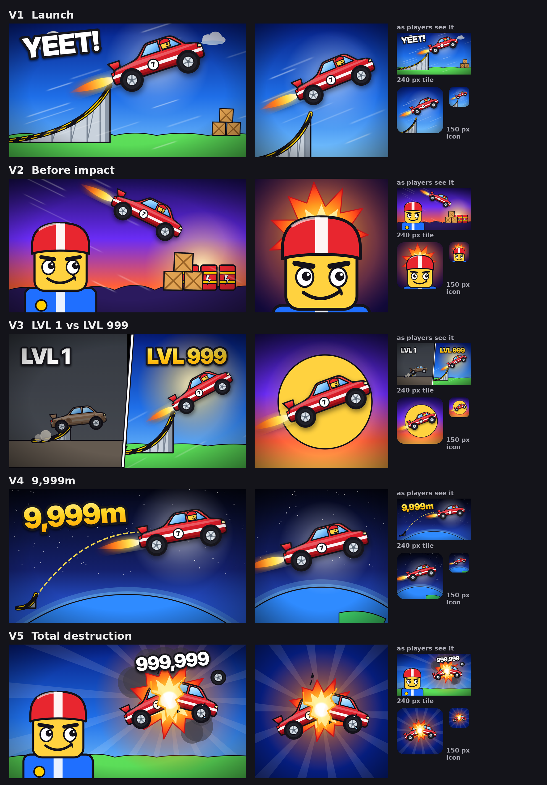

# Yeet a Car: thumbnails & icon, 5 iterations

Concept art for **Yeet a Car** (launch a car off a ramp and destroy it), built on
[`reports/thumbnails/MRBEAST_THUMBNAIL_STUDY.md`](../../reports/thumbnails/MRBEAST_THUMBNAIL_STUDY.md).
Each iteration is a 1920×1080 thumbnail plus a square icon (1024 px and 512 px), and each tests a
different *reason to click* so Roblox thumbnail personalisation can learn which works for whom.



> **These are composition comps, not final uploads.** Roblox asks for thumbnails that show what
> players actually get. Recreate the chosen layouts in Studio with your real car, ramp, avatar and
> explosion VFX (production notes below), then run `bpe thumbs score` on the render.

## Brand system (shared by every iteration)

| Element | Choice | Why |
|---|---|---|
| Hero car | Cherry red `#e01e2b`, white racing stripe, number 7 | Red on blue is a complementary contrast; one recognisable car across every image |
| Sky | Deep navy `#061f86` → blue `#1f6fe8` → `#7cc8ff`, with a vignette | Dark edges give bright subjects value contrast at small sizes |
| Blast | White core → yellow → orange → red | The destruction payoff; the warmest, brightest thing in frame |
| Hero mascot | Blocky avatar, red striped helmet, closed-mouth confident grin, eyes on the action | One big face whose gaze steers attention; closed mouth won MrBeast's watch-time tests |
| Type | Inter Display Black, white or gold gradient, heavy dark outline, 1–2 tokens | Reads on any background; numbers over words |
| Safe zone | Nothing essential in the bottom 15% | Roblox overlays the player count there |

## The five iterations

| | Archetype | Thumbnail idea | Text | Icon idea | Research applied |
|---|---|---|---|---|---|
| **v1** | The verb | Car flying off a mega ramp toward crates | "YEET!" | Car leaving the ramp lip | Show the core action plainly; promise the target |
| **v2** | Stakes moment | Big hero face, eyes up at the car diving toward explosive barrels | none | Hero mascot head on a burst | Faces draw gaze (Cerf 2009); gaze cues steer attention to the hook; the beat *before* impact creates a curiosity gap |
| **v3** | Progression contrast | Dreary "LVL 1" junk car hopping a tiny ramp vs gold "LVL 999" car blasting off a mega ramp | "LVL 1" / "LVL 999" | Car silhouetted on a giant sun | MrBeast's "$1 vs $1M" split, his best concept pattern (×1.38) |
| **v4** | Progress counter | Car in near-space above a curved planet, dashed flight path from a tiny ramp | "9,999m" | Car over the planet | The number tells the story ("DAY 97" pattern); no-face variant to test |
| **v5** | Signature mechanic | Car snapping in half inside an explosion, damage number popping, hero grinning | "999,999" | Car snapping in half in a blast | The payoff moment; one focal cluster (number + blast + car) plus one face |

### Scores (`bpe thumbs score`, final round)

| | Thumbnail | Icon |
|---|---|---|
| v1 | 0 fail · 0 warn · focal 3 · squint 15.6 | 0 fail · 1 warn (squint 15.6, p10–p25) |
| v2 | 0 fail · 0 warn · focal 2 · squint 18.0 | 0 fail · 0 warn · squint 20.6 |
| v3 | 0 fail · 1 warn (squint 15.0, inherent to a two-halves split) · focal 3 | 0 fail · 0 warn · squint 22.5 |
| v4 | 0 fail · 0 warn · focal 1 · squint 16.6 | 0 fail · 0 warn |
| v5 | 0 fail · 0 warn · focal 2 · squint 16.9 | 0 fail · 0 warn |

Every design is at least as colourful and saturated as MrBeast's median 2022+ thumbnail. Each
folder also has a `*-preview.png` showing the image at real display sizes and in the squint and
greyscale tests.

## What changed between rounds

Round 1 is kept in [`iterations/`](iterations/). The scorer and a visual review drove round 2:

| Problem in round 1 | Fix | Result |
|---|---|---|
| Flat mid-tones blurred when small (squint 10–14 on six designs) | Darker navy sky top, vignette, halos behind subjects; dark backdrop for the v2 icon; charcoal "LVL 1" half | v2 icon squint 10.9 → 20.6; v3 thumbnail 10.1 → 15.0; v5 thumbnail 14.0 → 16.9 |
| v5 thumbnail had 4 focal regions and text in the bottom strip | Removed the raised arm, cut shards from 16 to 7, moved the number into the explosion as a damage popup | Focal 4 → 2, all warnings cleared |
| v1 showed the launch but not the destruction | Crates waiting in the landing zone; bigger car | Hook now reads as "launch → smash" |
| v2's target was too small to sell the stakes | Barrels and crates scaled ×1.3 | Clear impact point under the diving car |
| v1/v5 bottom strip held 20–24% of attention | Ramp base moved off-frame, text moved up | Bottom share ≤ 0.20 everywhere |
| v5 icon: car halves lost in the blast; v2/v5 icons touched the edges | Smaller blast, larger car pieces, fewer shards, safe margins for rounded corners | Car halves read at 150 px |

## Recommendation

- **Thumbnails:** upload all five and activate them for **thumbnail personalisation** (Roblox
  allows 2–5 active; testing averaged +8.5% qualified play-through). Expect **v5** (the payoff)
  and **v3** (the contrast) to lead, based on the study, but let the data decide. Replace the
  weakest one or two with each game update.
- **Icon:** only one icon is shown per locale, so choose deliberately. Use **v5** (car snapping in
  a blast): it says "launch a car and destroy it" in one glance, which is what the docs ask an icon
  to do (express theme and genre). **v3** (car on the sun) is the strongest alternative: the
  cleanest silhouette at 64–150 px. **v2** (mascot head) is best for brand recognition, but it
  doesn't say "cars" on its own.
- **Keep the hero consistent:** the same helmeted mascot in v2/v5 and the same red #7 car
  everywhere turn five thumbnails into one recognisable brand.

## Production notes: recreating in Studio

1. **Capture:** use Studio freecam (Left Shift + P in a solo playtest) for low, wide angles. Shoot
   the car mid-air off your real ramp, and the break-apart frame from your actual destruction
   system.
2. **Hero:** use a dynamic head with a closed-mouth confident expression, eyes toward the car.
   Frame it large: the head at roughly 10–15% of the frame, as in MrBeast's recent thumbnails.
3. **Light:** add a rim light behind the hero and the car so both separate from the sky; keep the
   background slightly darker than the subject (the squint test).
4. **Stay authentic:** every number on a thumbnail must be reachable in-game ("9,999m",
   "999,999", "LVL 999"). If your max distance or damage is lower, use the real top value. Don't
   show cars, ramps or effects that aren't in the game.
5. **Export:** 1920×1080 (thumbnails) under 3 MB and 512×512 or larger (icon). Then run:
   ```bash
   bpe thumbs score my_render.png
   bpe thumbs score my_icon.png --kind icon
   ```

## Regenerating these comps

```bash
cd designs/yeet-a-car
python3 compose.py                                         # writes v*/thumbnail.svg, v*/icon.svg
NODE_PATH=$(npm root -g) node render.cjs v1 v2 v3 v4 v5    # SVG -> PNG via headless Chromium
```

`kit.py` holds the reusable parts (car, broken car, ramp, avatar, explosion, text, vignette).
`compose.py` holds the five layouts. The SVGs are editable in Figma, Illustrator or Inkscape.
